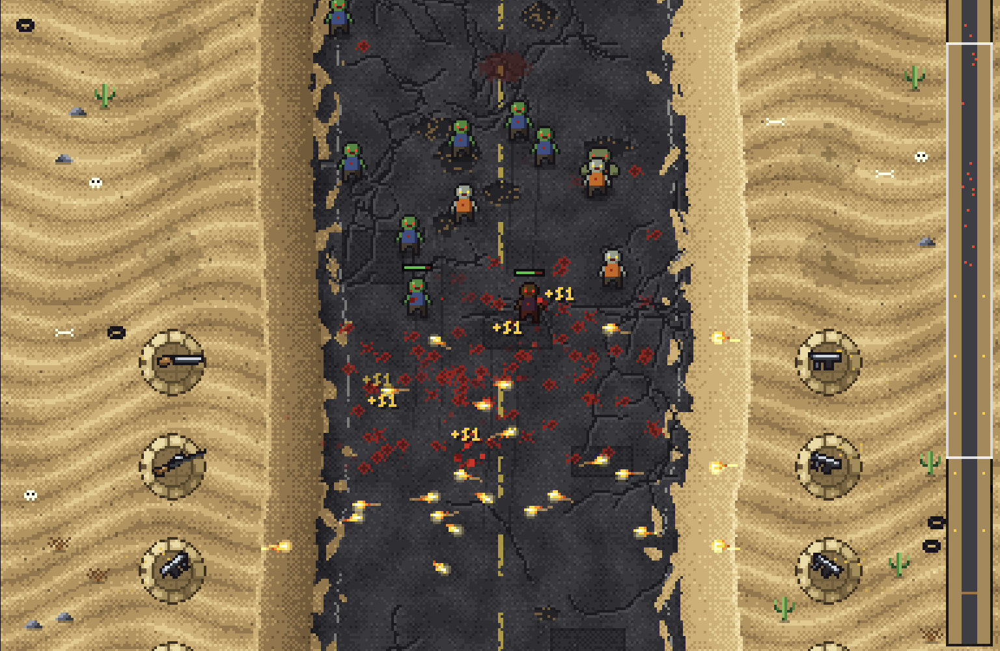
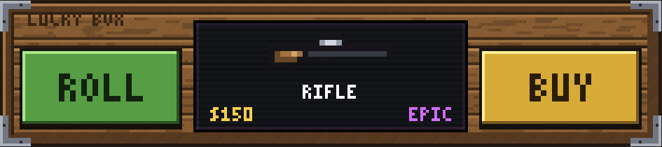
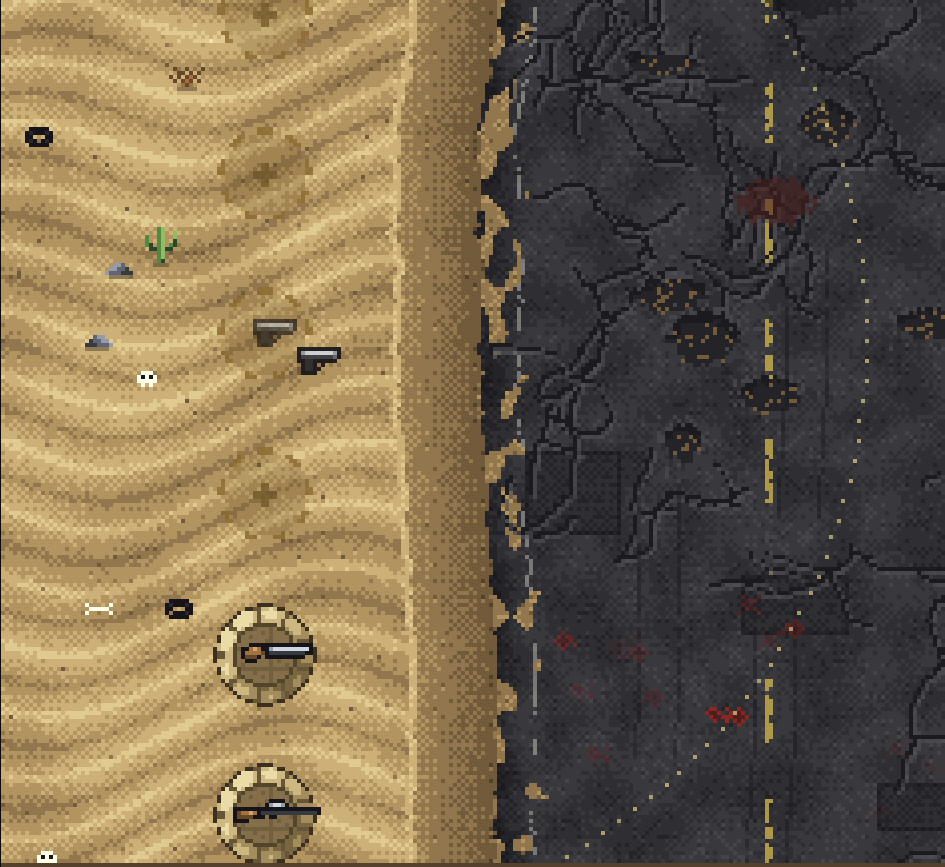
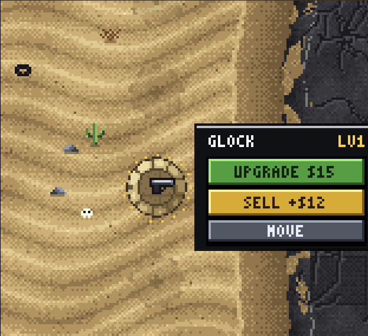
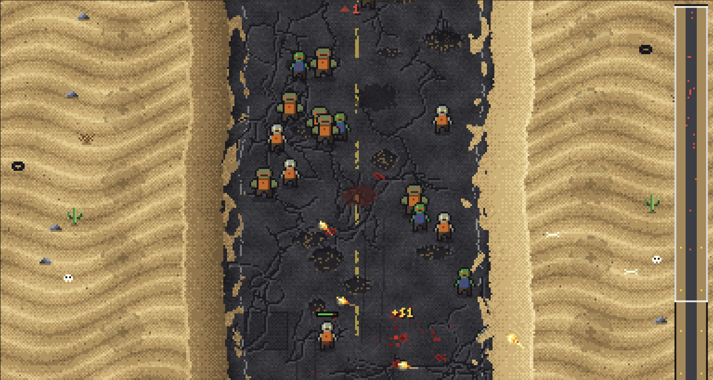
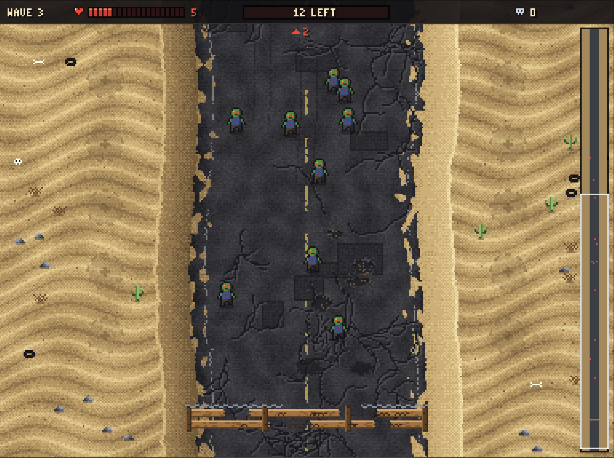
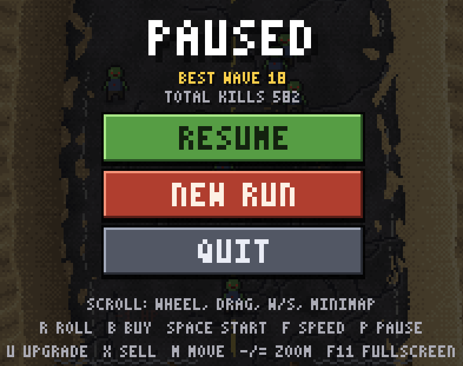

<div align="center">

# 🧟 Zombie Rush

**A tiny pixel-art zombie defense game. Roll the lucky box, arm the dunes, hold the road.**




</div>

---

## About

A wrecked desert highway cuts between two sand dunes. Every wave, the dead shamble down it toward your wooden barricade.

You can't build anything. All you have is a **lucky box**. Rolling it is free. Whatever comes out has a price tag, though, and the rare guns aren't cheap. Buy what you can afford, dig it into one of the **20 sandbag emplacements** along the dunes, and start the wave when you're ready.

Each kill earns **$1**, and clearing a wave pays a bonus. Spend it on more guns, or upgrade the ones you already have. The barricade has 20 HP. Each zombie that reaches it knocks some off, and when it runs out, the run is over.

The whole game is a single `main.lua` file. There are no image or sound files: every sprite, the font and the desert map are generated from code when the game starts.

---

## Features

- 🎲 **Lucky box.** Rolls are free, and four weapons come out at different rarities and prices.
- 🔫 **Four weapons.** The Glock, Uzi, Shotgun (spread shot) and Rifle (pierces several zombies) each behave differently, and each upgrades up to level 3.
- 🧟 **Three zombie types.** Walkers, fast runners and armored brutes show up as the waves get harder.
- 🗺️ **Long scrolling map** with a minimap, 10 gun slots per side, and a barricade that cracks as it takes damage.
- 🛠️ **Turret management.** Upgrade, sell (50% refund) or move any placed gun.
- ⏩ **Speed controls.** Play at normal speed or 2× fast-forward, and pause at any time.
- 💾 **Autosave.** Close the game whenever you like. If you quit mid-wave, you resume from the start of that wave.
- 🖥️ **Automatic scaling.** The game picks the sharpest whole-number pixel scale for your screen. You can zoom with `-` / `=` and switch to fullscreen with `F11`.
- 🎨 **Generated pixel art.** Dithered sand dunes, a cracked road with potholes and patches, muzzle flashes, glowing tracers, shell casings and blood splats.

---

## Screenshots

<table>
<tr>
<td width="50%">


**The lucky box.** Rolling is free. The price is what decides whether you take the gun.

</td>
<td width="50%">


**Dig in.** Pick any of the 20 emplacements. The dotted ring shows the gun's range.

</td>
</tr>
<tr>
<td width="50%">


**Upgrade, sell or move.** Click any gun to manage it, even during a wave.

</td>
<td width="50%">


**The horde grows.** Runners and brutes start appearing in later waves.

</td>
</tr>
<tr>
<td width="50%">


**Hold the line.** The barricade visibly breaks apart as you lose HP.

</td>
<td width="50%">


**Pause anytime.** The pause menu shows your stats and a controls cheat-sheet.

</td>
</tr>
</table>

---

## Quick start

1. Install **[LÖVE 11.5](https://love2d.org)**.
   > **macOS note:** Homebrew has disabled the `love` cask, so download the `.zip` from love2d.org, drag `love.app` into Applications, and run `xattr -dr com.apple.quarantine /Applications/love.app` once.
2. Clone this repository:
   ```bash
   git clone https://github.com/krzysztofgas/zombierush
   cd zombierush
   ```
3. Run it:
   ```bash
   love .
   ```
   If `love` isn't on your PATH, drag the project folder onto the LÖVE app instead.

---

## How to play

1. **Roll** the lucky box. It's free, and you can roll as many times as you like.
2. **Buy** the weapon if you can afford it, or roll again.
3. **Click a sand slot** to dig the gun in. Guns aim and fire on their own.
4. Press **START WAVE** when you're ready.
5. Earn **$1 per kill** plus a **wave bonus**, then upgrade and expand before the next wave.

### Controls

| Action                                 | Mouse                             | Keyboard                                       |
| -------------------------------------- | --------------------------------- | ---------------------------------------------- |
| Roll the lucky box                     | **ROLL** button                   | `R`                                            |
| Buy the rolled weapon                  | **BUY** button                    | `B`                                            |
| Place / select a gun                   | Left-click a slot                 |                                                |
| Cancel placing / deselect              | Right-click                       | `Esc`                                          |
| Upgrade / sell / move the selected gun | Panel buttons                     | `U` / `X` / `M`                                |
| Start the next wave                    | **START WAVE**                    | `Space` / `Enter`                              |
| Scroll the map                         | Wheel, drag, or click the minimap | `W` `S` / `↑` `↓`, `PgUp` `PgDn`, `Home` `End` |
| Fast-forward (1× / 2×)                 | **1X** button                     | `F` / `Tab`                                    |
| Pause                                  | **II** button                     | `P` / `Esc`                                    |
| Zoom pixels smaller / bigger           |                                   | `-` / `=`                                      |
| Fullscreen                             |                                   | `F11`                                          |

### Arsenal

| Weapon      | Price | Rarity   | What it does                                                          |
| ----------- | ----: | -------- | --------------------------------------------------------------------- |
| **Glock**   |   $25 | Common   | A reliable starter pistol.                                            |
| **Uzi**     |   $60 | Uncommon | Very fast fire, but less damage and wide spray.                       |
| **Shotgun** |   $90 | Rare     | Fires a 6-pellet fan. Short range, devastating up close.              |
| **Rifle**   |  $150 | Epic     | Long range and heavy damage, and each bullet pierces up to 3 zombies. |

Each upgrade (up to **level 3**) adds +50% damage, fires 12% faster and reaches 10% further. Selling refunds 50% of everything you spent on that gun.

### The dead

| Zombie     | Appears from | Notes                                                   |
| ---------- | ------------ | ------------------------------------------------------- |
| **Walker** | Wave 1       | Sways slowly down the road.                             |
| **Runner** | Wave 3       | Pale and fast, but fragile.                             |
| **Brute**  | Wave 5       | Slow and very tanky. Breaks **3 HP** off the barricade. |

Every 5th wave brings extra brutes.

---

## Save data

The game autosaves after every change you make between waves and whenever a wave starts or ends. Your best run, total kills and display settings are kept too.

| OS      | Running with `love .`                            | Running the packaged executable             |
| ------- | ------------------------------------------------ | ------------------------------------------- |
| Windows | `%APPDATA%\LOVE\zombierush\`                     | `%APPDATA%\zombierush\`                     |
| macOS   | `~/Library/Application Support/LOVE/zombierush/` | `~/Library/Application Support/zombierush/` |
| Linux   | `~/.local/share/love/zombierush/`                | `~/.local/share/zombierush/`                |

To wipe your progress, delete that folder. You can also choose **NEW RUN** from the pause menu, which keeps your stats. Saves carry a checksum and a backup copy, so a damaged file won't crash the game. It falls back to the backup or starts a fresh run instead.
